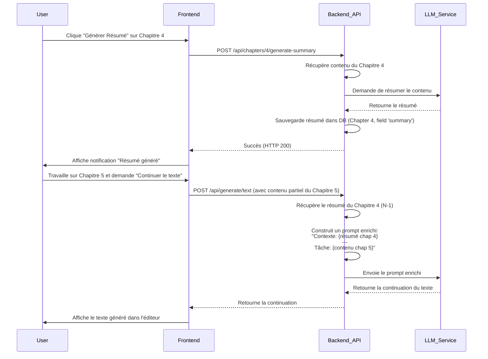

# Plan d'Implémentation : Gestion du Contexte Inter-Chapitres

**Document ID:** CTX-PLAN-V1

**Date:** 17/06/2025

**Objectif:** Détailler les étapes techniques pour implémenter deux stratégies de gestion du contexte narratif entre les chapitres, afin d'améliorer la pertinence et la cohérence des assistances IA.

## 1. Principes Directeurs et Contraintes

1.  **Économie de Contexte :** La contrainte principale est d'éviter la surcharge de la fenêtre de contexte du LLM. Pour ce faire, **seuls les résumés de chapitre (`summary`) seront utilisés comme contexte**, jamais le contenu textuel complet.
2.  **Modularité :** L'implémentation doit être modulaire. L'Approche 1 est une fondation nécessaire et un produit viable en soi. L'Approche 2 s'appuiera sur les développements de l'Approche 1.
3.  **Performance :** Les opérations de récupération de contexte ne doivent pas ralentir de manière perceptible l'expérience utilisateur. Les appels IA pour la génération de résumés doivent être asynchrones et non bloquants.
4.  **Clarté de l'Interface :** L'utilisateur doit comprendre, à tout moment, quel contexte est utilisé (ou comment l'activer).

---

## 2. Approche 1 : Contexte Automatique du Chapitre Précédent (MVP)

Cette approche est la base fondamentale. Elle vise à automatiser l'injection du résumé du chapitre N-1 lors du travail sur le chapitre N.

### 2.1. Concept et Flux Utilisateur

L'utilisateur écrit le contenu d'un chapitre. Une fois satisfait, il clique sur un nouveau bouton "Générer le résumé" associé à ce chapitre. L'application génère et stocke ce résumé en arrière-plan. Par la suite, lorsqu'il demande une assistance IA dans le chapitre suivant, le système injecte automatiquement le résumé du chapitre précédent dans le prompt, de manière totalement transparente pour l'utilisateur.

### 2.2. Diagramme de Séquence (Génération et Utilisation)



### 2.3. Plan d'Implémentation Détaillé

#### Étape 1: Modifications Backend (Modèle de Données)

*   **Fichier à modifier :** `backend/models.py`
*   **Action :** Ajouter un champ `summary` au modèle SQLAlchemy `Chapter`. Ce champ stockera le résumé textuel.
*   **Code :**
    ```python
    # Dans backend/models.py, à l'intérieur de la classe Chapter

    class Chapter(Base):
        # ... autres champs existants (id, title, content, order, project_id)
        summary: Mapped[Optional[str]] = mapped_column(Text, nullable=True)
    ```
*   **Action Secondaire :** Mettre à jour les schémas Pydantic correspondants (ex: `ChapterRead`, `ChapterUpdate`) pour inclure `summary: Optional[str] = None`.
*   **Migration DB :** Pour le développement avec SQLite, une suppression et recréation du fichier `instance/cyberplume.db` peut suffire. Pour la production, une migration (ex: avec Alembic) serait nécessaire.

#### Étape 2: Modifications Backend (API et Services)

*   **Fichier à modifier :** `backend/routers/chapters.py` (ou créer un nouveau routeur si jugé plus propre).
*   **Action :** Créer une nouvelle route API pour déclencher la génération du résumé.
*   **Code (Route API) :**
    ```python
    # Dans backend/routers/chapters.py
    from ..services import summary_service # Nouveau service à créer

    @router.post("/chapters/{chapter_id}/generate-summary", response_model=schemas.Chapter)
    async def generate_chapter_summary(
        chapter_id: int,
        db: Session = Depends(get_db)
    ):
        chapter = await summary_service.generate_and_save_summary(db=db, chapter_id=chapter_id)
        return chapter
    ```
*   **Action :** Créer un nouveau module de service, `backend/services/summary_service.py`.
*   **Code (Service de Génération) :**
    ```python
    # Dans backend/services/summary_service.py
    from .. import crud, models
    from ..ai_services.factory import AIFactory
    from ..utils.text_extractor import extract_text_from_html # Utilitaire existant

    async def generate_and_save_summary(db: Session, chapter_id: int) -> models.Chapter:
        chapter = crud.get_chapter(db, chapter_id)
        if not chapter or not chapter.content:
            raise HTTPException(status_code=404, detail="Chapter or content not found")

        # 1. Extraire le texte brut
        plain_text_content = extract_text_from_html(chapter.content)

        # 2. Préparer l'appel IA
        ai_adapter = AIFactory.create_adapter(provider="gemini") # Ou le fournisseur par défaut
        
        prompt = (
            "Tu es un assistant éditorial spécialisé dans la concision. "
            "Résume le texte de chapitre suivant en 150 mots maximum. "
            "Concentre-toi sur les événements clés, les révélations, l'évolution des personnages et les nouveaux éléments d'intrigue introduits. "
            "Ignore les descriptions mineures. Le résumé doit être dense et informatif.\n\n"
            f"TEXTE DU CHAPITRE :\n---\n{plain_text_content}"
        )

        # 3. Générer le résumé
        # Note: L'adaptateur doit exposer une méthode simple de génération
        generated_summary = await ai_adapter.generate_text(prompt, max_tokens=250)

        # 4. Sauvegarder en BDD
        chapter.summary = generated_summary.strip()
        db.commit()
        db.refresh(chapter)
        
        return chapter
    ```

*   **Action :** Modifier la logique d'injection de contexte dans les services IA existants.
*   **Fichier à modifier :** Le(s) service(s) qui gère(nt) les appels IA pour la génération de texte (ex: `backend/routers/ideas.py` ou un service dédié).
*   **Code (Logique d'Injection) :**
    ```python
    # Avant d'appeler le LLM pour continuer le texte du `current_chapter`
    
    # Récupérer le chapitre précédent basé sur son ordre
    previous_chapter = db.query(models.Chapter).filter(
        models.Chapter.project_id == current_chapter.project_id,
        models.Chapter.order < current_chapter.order
    ).order_by(models.Chapter.order.desc()).first()

    context_prefix = ""
    if previous_chapter and previous_chapter.summary:
        context_prefix = f"Pour votre information, voici le résumé du chapitre précédent:\n'''\n{previous_chapter.summary}\n'''\n\n---\n\n"

    # Construire le prompt final
    final_prompt = f"{context_prefix}{user_prompt_or_task}"

    # Envoyer `final_prompt` au LLM
    ```

#### Étape 3: Modifications Frontend

*   **Fichier à modifier :** `frontend/src/components/ChapterListItem.vue` (ou un menu contextuel).
*   **Action :** Ajouter un bouton pour déclencher la génération de résumé.
*   **Code (Template Vue) :**
    ```html
    <!-- Dans la boucle v-for des chapitres -->
    <v-list-item>
      <!-- ... titre, autres boutons ... -->
      <template v-slot:append>
        <v-tooltip text="Générer/Mettre à jour le résumé">
          <template v-slot:activator="{ props }">
            <v-btn
              icon
              variant="text"
              v-bind="props"
              @click.stop="handleGenerateSummary(chapter.id)"
              :loading="isSummaryLoading(chapter.id)"
            >
              <IconFileTextAi :size="20" />
            </v-btn>
          </template>
        </v-tooltip>
        <!-- ... autres boutons (renommer, supprimer) ... -->
      </template>
    </v-list-item>
    ```
*   **Action :** Ajouter la logique dans le script du composant.
*   **Code (Script Vue) :**
    ```javascript
    import { ref } from 'vue';
    import { useChapters } from '@/composables/useChapters'; // ou service API dédié
    import { useSnackbar } from '@/composables/useSnackbar';

    const { generateSummary } = useChapters();
    const { showSnackbar } = useSnackbar();
    const loadingSummaries = ref([]);

    const isSummaryLoading = (id) => loadingSummaries.value.includes(id);

    const handleGenerateSummary = async (chapterId) => {
      if (isSummaryLoading(chapterId)) return;
      
      loadingSummaries.value.push(chapterId);
      try {
        await generateSummary(chapterId);
        showSnackbar('Résumé généré avec succès.', 'success');
      } catch (error) {
        showSnackbar('Erreur lors de la génération du résumé.', 'error');
      } finally {
        loadingSummaries.value = loadingSummaries.value.filter(id => id !== chapterId);
      }
    };
    ```

---

## 3. Approche 2 : Contexte à la Carte (Sélection Manuelle)

Cette approche est une évolution de l'Approche 1. Elle donne à l'utilisateur un contrôle total sur les chapitres à inclure comme contexte.

### 3.1. Prérequis

L'Approche 1 doit être entièrement implémentée. Cette approche réutilise le champ `summary` et la logique de génération de résumé.

### 3.2. Concept et Flux Utilisateur

À côté de l'éditeur de texte, une nouvelle section ou un menu déroulant "Contexte Actif" est disponible. Il liste tous les chapitres du projet (avec leur résumé disponible en infobulle). L'utilisateur coche les chapitres qu'il souhaite utiliser comme contexte pour sa session d'écriture. Les appels IA suivants incluront les résumés des chapitres sélectionnés. Cette sélection est persistante pour la session de travail.

### 3.3. Diagramme d'Architecture Frontend

```mermaid
graph TD
    subgraph EditorView
        A[EditorComponent]
        B[ContextSelectorComponent]
    end

    subgraph Composables/Stores
        C[useContextManager (Store)]
    end

    D[useAIActions]

    B -- "Met à jour la liste des IDs de contexte" --> C
    A -- "Utilise une fonction IA" --> D
    D -- "Lit la liste des IDs de contexte" --> C
    D -- "Envoie les IDs au Backend" --> E[Backend API]

    style C fill:#f9f,stroke:#333,stroke-width:2px
```

### 3.4. Plan d'Implémentation Détaillé

#### Étape 1: Modifications Backend (API)

*   **Action :** Modifier les endpoints d'API qui effectuent la génération de texte pour accepter une liste d'IDs de chapitre pour le contexte.
*   **Fichier à modifier :** Le schéma Pydantic de la requête et la route API correspondante.
*   **Code (Schéma Pydantic) :**
    ```python
    # Dans le fichier de schémas Pydantic
    class GenerateTextRequest(BaseModel):
        prompt: str
        project_id: int
        current_chapter_id: int
        context_chapter_ids: Optional[List[int]] = None # NOUVEAU CHAMP
        # ... autres paramètres (style, modèle IA, etc.)
    ```
*   **Action :** Mettre à jour la logique d'injection de contexte pour utiliser cette liste.
*   **Code (Logique d'Injection) :**
    ```python
    # Dans le service qui gère la génération
    # Remplacer la logique de l'Approche 1 par ceci :

    context_prefix = ""
    if request_data.context_chapter_ids:
        # Récupérer les résumés des chapitres sélectionnés
        context_chapters = db.query(models.Chapter).filter(
            models.Chapter.id.in_(request_data.context_chapter_ids),
            models.Chapter.summary.isnot(None)
        ).order_by(models.Chapter.order).all()

        summaries = []
        for chapter in context_chapters:
            summaries.append(f"Résumé du Chapitre {chapter.order} ('{chapter.title}'):\n{chapter.summary}")
        
        if summaries:
            context_prefix = "Pour votre information, voici les résumés des chapitres pertinents sélectionnés:\n\n" + "\n\n---\n\n".join(summaries) + "\n\n---\n\n"

    # Construire le prompt final
    final_prompt = f"{context_prefix}{request_data.prompt}"
    ```

#### Étape 2: Gestion d'État Frontend

*   **Action :** Créer un composable (ou un store Pinia) pour gérer l'état de la sélection de contexte.
*   **Fichier à créer :** `frontend/src/composables/useContextManager.js`
*   **Code (Composable de Gestion d'État) :**
    ```javascript
    import { ref } from 'vue';

    const selectedContextIds = ref([]); // Array of chapter IDs

    export function useContextManager() {
        const setContextIds = (ids) => {
            selectedContextIds.value = ids;
        };

        const addContextId = (id) => {
            if (!selectedContextIds.value.includes(id)) {
                selectedContextIds.value.push(id);
            }
        };

        const removeContextId = (id) => {
            selectedContextIds.value = selectedContextIds.value.filter(i => i !== id);
        };

        return {
            selectedContextIds, // La ref réactive
            setContextIds,
            addContextId,
            removeContextId,
        };
    }
    ```

#### Étape 3: Création du Composant de Sélection Frontend

*   **Action :** Créer un nouveau composant `ContextSelector.vue`.
*   **Fichier à créer :** `frontend/src/components/ContextSelector.vue`
*   **Concept du Code (Template Vue) :**
    ```html
    <template>
      <v-card>
        <v-card-title>Contexte Actif</v-card-title>
        <v-list density="compact">
          <v-list-item v-for="chapter in projectChapters" :key="chapter.id">
            <template v-slot:prepend>
              <v-checkbox-btn
                :model-value="selectedContextIds"
                :value="chapter.id"
                @update:modelValue="setContextIds"
              ></v-checkbox-btn>
            </template>
            <v-list-item-title>{{ chapter.title }}</v-list-item-title>
            <v-tooltip v-if="chapter.summary" location="start">
              <template v-slot:activator="{ props }">
                <v-icon v-bind="props" size="x-small">mdi-information-outline</v-icon>
              </template>
              <div style="max-width: 300px;">{{ chapter.summary }}</div>
            </v-tooltip>
          </v-list-item>
        </v-list>
      </v-card>
    </template>
    ```
*   **Concept du Code (Script Vue) :** Le script importerait `useContextManager` et `useChapters`, récupérerait la liste des chapitres du projet et les lierait aux checkboxes et à l'état global.

#### Étape 4: Intégration et Modification des Appels API

*   **Action :** Intégrer `ContextSelector.vue` dans la vue principale de l'éditeur (ex: `ProjectManager.vue`).
*   **Action :** Modifier les composables qui effectuent les appels IA (ex: `useAIActions.js`).
*   **Fichier à modifier :** `frontend/src/composables/useAIActions.js`
*   **Code (Modification de l'appel API) :**
    ```javascript
    import { useContextManager } from './useContextManager';

    // Dans une fonction qui appelle l'API de génération
    export function useAIActions() {
      const { selectedContextIds } = useContextManager();

      const continueText = async (prompt, projectId, currentChapterId) => {
        const payload = {
          prompt,
          project_id: projectId,
          current_chapter_id: currentChapterId,
          context_chapter_ids: selectedContextIds.value // INJECTION DES IDs SÉLECTIONNÉS
        };
        // Appel axios.post('/api/generate/text', payload)
        // ...
      };

      return { continueText };
    }
    ```

---

## 4. Conclusion et Recommandation de Déploiement

1.  **Développer et fusionner l'Approche 1 en premier.** Elle offre 80% de la valeur avec 20% de la complexité. C'est une amélioration significative et autonome.
2.  Créer une nouvelle branche (`feature/manual-context-selection`) basée sur la branche principale *après* la fusion de l'Approche 1.
3.  **Développer l'Approche 2.** L'effort principal sera sur le frontend (création du composant de sélection et gestion de l'état), car le backend sera déjà prêt avec les résumés.

Cette approche séquentielle garantit une livraison de valeur progressive et réduit les risques liés au développement d'une fonctionnalité complexe en un seul bloc.